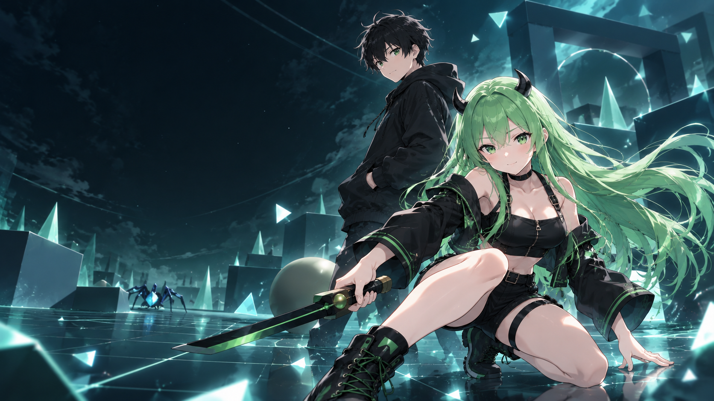
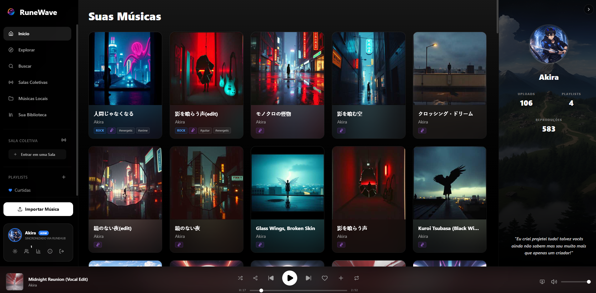
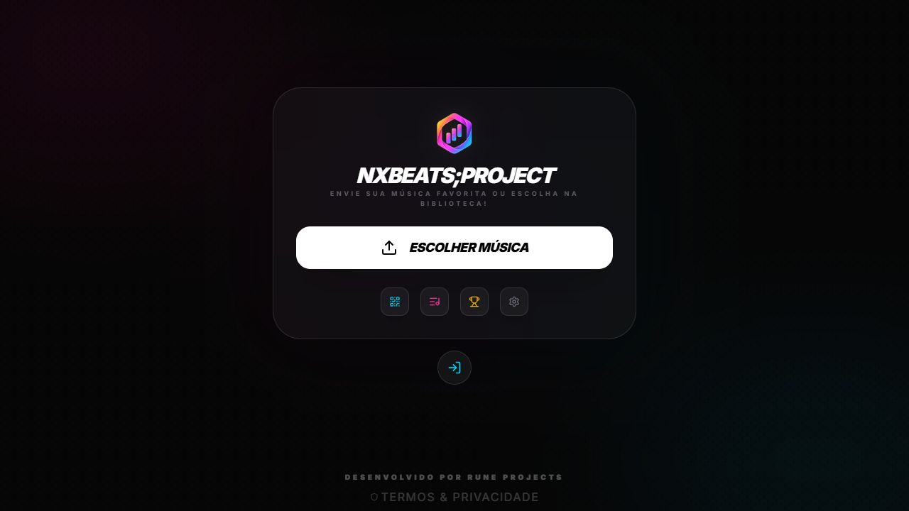

<p align="center">
  
</p>

<p align="center">
  <strong>Infraestrutura por profissão. Produtos, jogos e IA por curiosidade.</strong>
</p>

<p align="center">
  <a href="https://www.runeprojects.com.br"></a>
  <a href="https://github.com/guilhermealceu/runehub-releases/releases/latest/download/RuneHub-Installer.exe"></a>
  <a href="https://linkedin.com/in/guilhermealceu"></a>
</p>

## 👋 Sobre mim

Trabalho com **infraestrutura, segurança e automação há mais de 10 anos**: firewalls, servidores, virtualização, monitoramento e suporte a várias empresas ao mesmo tempo. Boa parte do que está aqui nasceu de um problema real do dia a dia, que eu resolvi com código.

No tempo livre construo o ecossistema da **[RUNE Projects](https://www.runeprojects.com.br)**: apps, jogos, música e narrativas, com a **Nixie** como personagem que atravessa esse universo. Os apps para desktop chegam pelo **[RuneHub](https://runehub.runeprojects.com.br/)**, um launcher para Windows com atualização automática.

```yaml
foco:        [infraestrutura, segurança, automação, IA local]
dia_a_dia:   [pfSense, Proxmox, Zabbix, GLPI, Windows Server, Microsoft 365]
construindo: [RUNE Projects, RuneHub, Nixie]
lema:        "O tempo só para se você não evoluir!"
```

<h2 align="center">🛠️ Ferramentas de infraestrutura · open source</h2>

<p align="center"><sub>Feitas para quem cuida de rede, servidor e suporte. Todas com IA <b>local</b> quando possível: seus dados ficam na sua máquina.</sub></p>

<table>
  <tr>
    <td width="50%" valign="top">
      <h3><a href="https://github.com/guilhermealceu/rune-lanscope">🛰️ RUNE LanScope</a></h3>
      <p>Descobre, identifica e diagnostica os equipamentos da rede local: inventário, topologia, histórico, relatórios e IA local.</p>
      <p><code>Electron</code> <code>Nmap</code> <code>Ollama</code></p>
    </td>
    <td width="50%" valign="top">
      <h3><a href="https://github.com/guilhermealceu/zabbix-vision">📡 Zabbix Vision</a></h3>
      <p>Dashboard moderno para Zabbix: topologia com impacto em cascata, flapping, correlação de eventos e previsão de incidentes.</p>
      <p><code>React</code> <code>Zabbix API</code></p>
    </td>
  </tr>
  <tr>
    <td width="50%" valign="top">
      <h3><a href="https://github.com/guilhermealceu/rune-map-topology">🗺️ RUNE Map Topology</a></h3>
      <p>Gera diagramas de topologia de rede a partir de backups do pfSense, com edição manual e auditoria local.</p>
      <p><code>React</code> <code>pfSense</code></p>
    </td>
    <td width="50%" valign="top">
      <h3><a href="https://github.com/guilhermealceu/pve-backup-bridge">🗄️ PVE Backup Bridge</a></h3>
      <p>Painel para vários clusters Proxmox VE: VMs, snapshots, backups sob demanda e rotinas de backup.</p>
      <p><code>Node.js</code> <code>Proxmox API</code></p>
    </td>
  </tr>
  <tr>
    <td width="50%" valign="top">
      <h3><a href="https://github.com/guilhermealceu/SharkAI">🦈 SharkAI</a></h3>
      <p>Analisa capturas do Wireshark: protocolos, IPs, linha do tempo, retransmissões e relatório com IA.</p>
      <p><code>TypeScript</code> <code>Groq</code></p>
    </td>
    <td width="50%" valign="top">
      <h3><a href="https://github.com/guilhermealceu/infrachat">💬 InfraChat</a></h3>
      <p>Pergunte em linguagem natural sobre a documentação de infraestrutura de cada cliente. IA local, documentos não saem da máquina.</p>
      <p><code>Electron</code> <code>Ollama</code> <code>OCR</code></p>
    </td>
  </tr>
  <tr>
    <td width="50%" valign="top">
      <h3><a href="https://github.com/guilhermealceu/pc-diagnostic-hub">🩺 PC Diagnostic Hub</a></h3>
      <p>Diagnóstico de hardware em tempo real com IA local: CPU, GPU, discos (SMART), bateria e processos.</p>
      <p><code>React</code> <code>SQLite</code> <code>Ollama</code></p>
    </td>
    <td width="50%" valign="top">
      <h3><a href="https://github.com/guilhermealceu/rune-infra-themes">🎨 RUNE Infra Themes</a></h3>
      <p>Temas visuais modernos para as interfaces web do pfSense e do GLPI.</p>
      <p><code>CSS</code> <code>pfSense</code> <code>GLPI</code></p>
    </td>
  </tr>
  <tr>
    <td width="50%" valign="top">
      <h3><a href="https://github.com/guilhermealceu/rune-repo-council">🧠 RUNE Repo Council</a></h3>
      <p>Conselho de agentes de IA que revisa repositórios do GitHub: arquitetura, segurança, performance e QA.</p>
      <p><code>Multiagente</code> <code>Groq</code> <code>Ollama</code></p>
    </td>
    <td width="50%" valign="top">
      <h3><a href="https://github.com/guilhermealceu/rune-theme-factory">🧩 RUNE Theme Factory</a></h3>
      <p>Gera temas do Chrome e todos os assets da Chrome Web Store a partir de uma imagem, já em .zip.</p>
      <p><code>Node.js</code> <code>Sharp</code></p>
    </td>
  </tr>
</table>

<p align="center">
  Mais utilitários:
  <a href="https://github.com/guilhermealceu/pfsense-scripts">pfSense Scripts</a> ·
  <a href="https://github.com/guilhermealceu/Root-Terminator">Root Terminator</a> ·
  <a href="https://github.com/guilhermealceu/AuraDock---Menu-Lateral-Inteligente">AuraDock</a> ·
  <a href="https://github.com/guilhermealceu/Protoboard-MB-102">RuneBoard</a> ·
  <a href="https://github.com/guilhermealceu/Nixie">Nixie (vitrine)</a>
</p>

<h2 align="center">🌌 No universo RUNE</h2>

<table>
  <tr>
    <td width="50%" align="center">
      <a href="https://nixiegame.runeprojects.com.br/">
        
      </a>
      <h3>Nixie · Crystal Garden</h3>
      <p>O universo original da Nixie, em um jogo 3D no navegador.</p>
      <a href="https://nixiegame.runeprojects.com.br/">Jogar</a> ·
      <a href="https://www.runeprojects.com.br/nixie">Conhecer o universo</a>
    </td>
    <td width="50%" align="center">
      <a href="https://runewave.runeprojects.com.br/">
        
      </a>
      <h3>RuneWave</h3>
      <p>Bibliotecas de música, reprodução local e salas de escuta compartilhada.</p>
      <a href="https://runewave.runeprojects.com.br/">Abrir a plataforma</a>
    </td>
  </tr>
  <tr>
    <td width="50%" align="center">
      <a href="https://nxbeats.runeprojects.com.br/">
        
      </a>
      <h3>NxBeats;Project</h3>
      <p>Análise de áudio, gameplay de ritmo e dificuldade dinâmica, com as suas músicas.</p>
      <a href="https://nxbeats.runeprojects.com.br/">Explorar o jogo</a>
    </td>
    <td width="50%" align="center" valign="top">
      <h3>Apps no RuneHub</h3>
      <p>
        <a href="https://github.com/guilhermealceu/steins-tracker"><strong>Steins;Tracker</strong></a><br />
        Monitora o tempo de jogo no PC, 100% local.<br />
        Também tem <a href="https://github.com/guilhermealceu/steins-tracker/releases">instalador público</a>.
      </p>
      <p>
        <a href="https://isekaitracker.runeprojects.com.br/"><strong>Isekai;Tracker</strong></a><br />
        Acompanhe animes no site ou no app para desktop, disponível somente pelo RuneHub.<br />
        Extensão: <a href="https://github.com/guilhermealceu/isekai-tracker-extension">isekai-tracker-extension</a>.
      </p>
    </td>
  </tr>
</table>

<p align="center"><sub>Crystal Garden: arte oficial · RuneWave: captura do produto · NxBeats: tela inicial pública.</sub></p>

<p align="center">
  Também fazem parte do estúdio o <a href="https://finanrune.runeprojects.com.br/">FinanRune</a>,
  a página da <a href="https://www.runeprojects.com.br/nixie">Nixie</a>
  e o marketplace do <a href="https://runehub.runeprojects.com.br/">RuneHub</a>.
  Alguns repositórios de código permanecem privados; o que está publicado aparece no site e no launcher.
</p>

<p align="center">
  <a href="https://www.runeprojects.com.br"><strong>Ver todos os projetos →</strong></a>
</p>

<h2 align="center">⚙️ Tecnologias</h2>

<p align="center">
  
  
  
  
  
  
  
</p>

<p align="center">
  
  
  
  
  
  
</p>

<p align="center"><sub>Windows Server · Microsoft 365 · Google Workspace · Fortinet · Sophos · Hyper-V · GLPI<br />REST APIs · WebSockets · Stable Diffusion · LoRA · Whisper · TTS · OpenCV · VRM</sub></p>

<p align="center">
  
</p>
